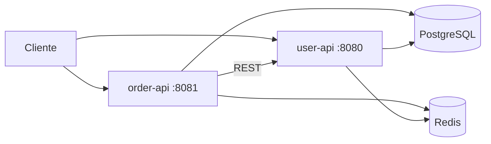

# Microsserviços de Usuários e Pedidos

Dois microsserviços REST em **Spring Boot** que se comunicam entre si: um de cadastro de usuários e outro de pedidos. Ao criar um pedido, o serviço de pedidos consulta o serviço de usuários para validar se o usuário existe e devolve os dados dele junto com o pedido.



## Tecnologias
- Java 17 e Spring Boot 3.3
- Spring Web e Spring Data JPA (Hibernate)
- PostgreSQL
- Redis com Spring Cache (`@Cacheable` e `@CacheEvict`)
- `RestTemplate` na comunicação entre os serviços
- springdoc-openapi (Swagger)
- JUnit 5 e Mockito
- Lombok
- Docker Compose para PostgreSQL e Redis

## Decisões técnicas
- **Consistência entre serviços:** o `order-api` só grava um pedido depois de confirmar, no `user-api`, que o usuário existe.
- **Cache com invalidação:** as consultas ficam em cache no Redis, e toda escrita (criar, alterar, excluir) invalida o cache correspondente.
- **Erros padronizados:** um `@RestControllerAdvice` centraliza o tratamento de exceções e devolve sempre um JSON de erro no mesmo formato.
- **DTOs com `records`:** os dados de entrada chegam em `records`, separados das entidades JPA, e o pedido é devolvido em um DTO de resposta que inclui os dados do usuário.
- **Camadas:** controller, service, repository e model separados, com a regra de negócio concentrada na camada de serviço.

## Endpoints

### user-api (porta 8080)

| Método | Rota | Descrição |
| --- | --- | --- |
| POST | `/users` | Cria um usuário |
| GET | `/users` | Lista os usuários |
| GET | `/users/{id}` | Busca um usuário por id |
| PUT | `/users/{id}` | Atualiza um usuário |
| DELETE | `/users/{id}` | Remove um usuário |

Usuário: `name`, `cpf`, `email`, `phoneNumber`, além de `id`, `createdAt` e `updatedAt` gerados pela aplicação.

### order-api (porta 8081)

| Método | Rota | Descrição |
| --- | --- | --- |
| POST | `/orders` | Cria um pedido, validando o usuário no `user-api` |
| GET | `/orders` | Lista os pedidos |
| GET | `/orders/{id}` | Busca um pedido por id, com os dados do usuário |
| PUT | `/orders/{id}` | Atualiza um pedido |
| DELETE | `/orders/{id}` | Remove um pedido |

Pedido: `userId`, `itemDescription`, `itemQuantity`, `itemPrice` e `totalValue`, além de `id`, `createdAt` e `updatedAt`.

A especificação OpenAPI de cada serviço está em [`docs/`](docs), e o Swagger fica disponível em `/swagger` com as aplicações rodando.

## Como executar

Pré-requisitos: Java 17 e Docker.

```bash
# 1. PostgreSQL (na raiz do projeto)
docker compose up -d

# 2. Redis, compartilhado pelos dois serviços
cd user-api && docker compose up -d

# 3. user-api (porta 8080)
./mvnw spring-boot:run

# 4. order-api (porta 8081), em outro terminal
cd order-api && ./mvnw spring-boot:run
```

No Linux ou macOS, se o `mvnw` não tiver permissão de execução, rode `chmod +x mvnw` antes.

Swagger: http://localhost:8080/swagger e http://localhost:8081/swagger

## Testes

Testes unitários da camada de serviço com JUnit 5 e Mockito, nos dois microsserviços:

```bash
./mvnw test
```
